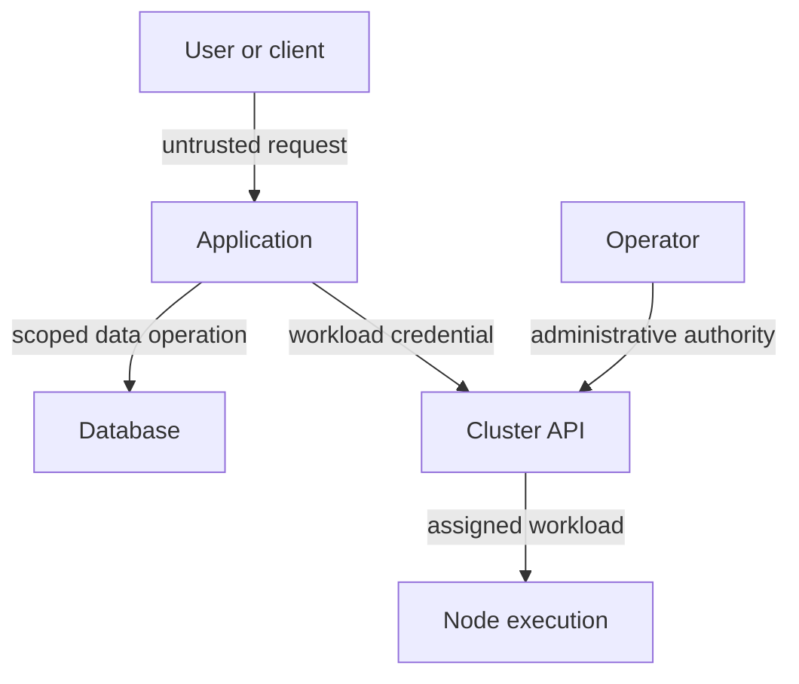

# Tracing Authority Across The Platform

A threat model is a structured account of what can go wrong, how harm can occur and which controls address it. For Kubernetes, start with the assets and data flows rather than a list of product vulnerabilities. The model should describe the actual environment and its trust assumptions.

## Assets, Actors And Entry Points

Assets include application data, application programming interface (API) credentials, image artifacts, cluster configuration and service availability. Actors include users, workloads, operators, build systems and external services. Some actors are intentionally trusted for selected actions, while others supply untrusted input. Trust should be scoped to a responsibility rather than assigned universally to an identity name.

An entry point is a place where an actor can interact with the system: an application endpoint, API server, repository, node agent or administrative workstation. The effect depends on the reachable interface and available authority. A public web input and a runtime management socket are both entry points with very different possible consequences.

A trust boundary is a transition where one set of assumptions or privileges gives way to another. User-to-application, application-to-database, workload-to-API and control-plane-to-node are useful examples. State what authenticates and authorizes the transition and which data becomes trusted afterward.

## Following A Request

The `shuttle` application submits a report request to `probe`. A network connection reaches a gateway or Service. Transport security can verify a peer and encrypt a hop. Application authentication identifies the user or caller. Authorization checks whether that identity may create the report. The backend then writes data through its own database identity.

Each transition can fail differently. An allowed network path does not establish application permission. A valid user credential does not authorize every report. A database role available to `probe` does not mean every incoming request should be allowed to use its full power. The application mediates that authority.

The same application can cross several boundaries using different identities and permissions.

## Control Plane And Supply Chain

A workload's image originates in a build and repository workflow before a node executes it. Source authors, build credentials and registry publishers therefore participate in the execution trust chain. A compromised build can introduce unwanted behavior without attacking the API server directly.

Cluster administrators and node administrators have powerful positions in the model. A node controller can affect local runtime and plaintext data. A cluster administrator can change workloads and permissions. Namespace isolation depends on these trusted systems, so mutually untrusted tenants may require stronger management or execution boundaries.

## Linking Threats To Controls

For each path, describe a possible misuse and consequence. A stolen deployment credential can create an overly privileged workload. Narrow API grants, admission checks, runtime restrictions and audit records address different stages. A blocked connection can reduce exposure, while rotation and trusted restoration handle a confirmed credential compromise.

Document assumptions such as trusted node hosts, controlled label ownership and an enforcing network implementation. Then identify what changes if an assumption fails. A diagram is useful only when it exposes those relationships and supports concrete control decisions.

## Common pitfalls

> [!WARNING]
> An internal network or familiar identity is not a universal trust guarantee. Trace each transition's authority and data rather than assuming the entire platform shares one security boundary.
