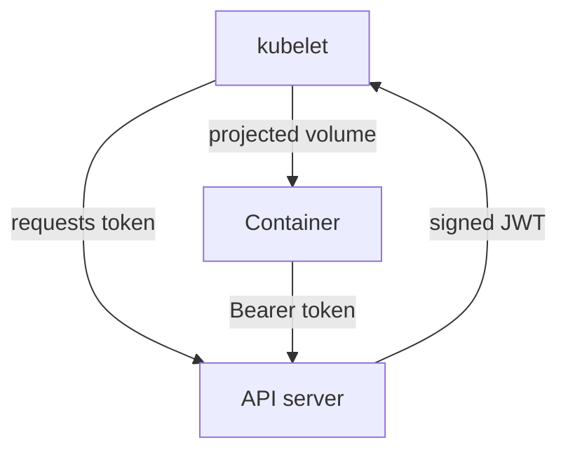

# Entry Points And Workload Credentials

Every pod receives a credential by default, even when its code never calls the Kubernetes API. That credential is an entry point: anyone who runs code inside the container can use it. This part shows where the credential sits, what it can do and how to stop mounting it when the workload does not need it.

## How The Credential Reaches A Container

When a pod starts, the kubelet (the node agent that runs pods) asks the API server for a short-lived token for the pod's service account. The kubelet mounts the token as a projected volume at `/var/run/secrets/kubernetes.io/serviceaccount`. The same directory holds the cluster certificate authority file `ca.crt` and the namespace name.

The API server adds this volume automatically through the `ServiceAccount` admission controller. A pod gets it unless the pod or its service account sets `automountServiceAccountToken: false`. The token is a JSON Web Token (JWT) signed by the API server. It has an expiry, and the kubelet refreshes it before it ends.

Any process in the container can read the file. This includes the application and any code an attacker injects into it. The attacker then sends requests to the API server with the header `Authorization: Bearer <token>`, and the API server treats the request as coming from the service account.



The diagram shows that the container holds a credential for the same API server that issued it.

## Checking What A Workload Carries

Start with the files. The `shuttle` container is a `curl` image that only sends HTTP requests to Services. It never needs the Kubernetes API:

<!-- astrona:playground:renew -->
```sh
kubectl exec -n starfleet deploy/shuttle -- ls /var/run/secrets/kubernetes.io/serviceaccount
```

You should see the files `ca.crt`, `namespace` and `token`. The workload carries a credential that it does not use. Now check what that credential allows. The `can-i` command tests a request for an identity without sending the real request:

```sh
kubectl auth can-i get pods -n starfleet --as=system:serviceaccount:starfleet:shuttle
```

The answer is `no` on a fresh cluster, because no Role grants rights to `shuttle`. The token still works for authentication, and it allows the discovery requests that every authenticated identity may send. The risk grows the moment someone binds a Role to the service account for a different reason, because the token is already inside every `shuttle` pod.

## Removing The Credential

The principle is least authority: a workload that does not call the API should not hold an API credential. There are two places to set the field. On the service account, it applies to every pod that uses the account. On the pod template, it applies to one workload and overrides the account setting.

Save this as `patch-shuttle-no-token.yaml`:

```yaml
spec:
  template:
    spec:
      automountServiceAccountToken: false
```

Apply it as a patch:

```sh
kubectl patch deployment shuttle -n starfleet --patch-file patch-shuttle-no-token.yaml
```

Then check the result:

```sh
kubectl rollout status deployment/shuttle -n starfleet
kubectl exec -n starfleet deploy/shuttle -- ls /var/run/secrets/kubernetes.io/serviceaccount
```

The `ls` command should now fail with a message that the directory does not exist. The Deployment created a new pod without the projected volume.

## Choosing Where To Set The Field

Setting it on the service account is simple when all pods of an application share the account. Setting it on the pod template is safer when one workload needs the API and its sibling does not. Both are visible in the object, so a reviewer can find workloads that keep the default:

```sh
kubectl get deployments -n starfleet -o jsonpath='{range .items[*]}{.metadata.name}{"\t"}{.spec.template.spec.automountServiceAccountToken}{"\n"}{end}'
```

An empty value means the default applies, so the token is mounted.

## Other Entry Points A Pod Adds

The token is one entry point. A pod can add others: a published port, a `hostPort`, a shared volume, a `hostPath` mount and environment variables that carry secrets. For each one, ask three questions. Who can reach it, what authority does it give and which control limits it. A written answer for each entry point is the content of the threat model.

When the answer is "no one needs it", remove the entry point. Removing is stronger than detecting misuse, because nothing is left to misuse.

The part is complete when you can name the credential every pod carries, show it with one command and remove it for a workload that does not call the API. The next question is how requests move between layers, which the next module covers.

## Common pitfalls

> [!WARNING]
> Setting `automountServiceAccountToken: false` on the pod does not revoke tokens that were already copied elsewhere. A token that left the container stays valid until it expires or the service account is deleted. Also, a workload that does call the API, such as a controller, breaks when you remove the token.
