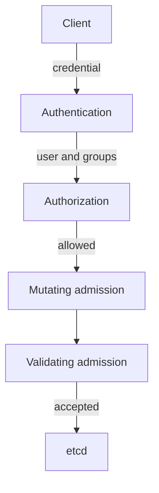

# The Order Of Decisions On An API Request

Every change to a Kubernetes object, and every read of one, is an HTTPS request to the API server. The API server does not trust the sender. It runs the request through three ordered stages, and a failure at any stage ends the request. Knowing the order lets you read an error message and know which control produced it.

## Authentication, Authorization And Admission

Authentication answers "who is this". The API server checks the client certificate, bearer token or other credential and produces a user name and groups. If no credential matches, the request continues as `system:anonymous` when anonymous access is enabled, or it fails with status 401.

Authorization answers "may this identity do this". The most common authorizer is role-based access control (RBAC). It looks at the user, the verb (`get`, `create`, `delete`), the resource and the namespace. A refusal returns status 403 and the message names the user, the verb and the resource.

Admission answers "is this object acceptable". Admission controllers run only for requests that change state. Mutating controllers may change the object, and validating controllers may reject it. Pod Security Admission and ValidatingAdmissionPolicy are examples. After admission, the API server validates the object and writes it to etcd.



The diagram shows that a read request stops after authorization, and a write request continues through admission to etcd.

## Seeing Each Stage In The Playground

Begin with authentication. The `kubectl auth whoami` command asks the API server which identity it sees for your credential:

<!-- astrona:playground:renew -->
```sh
kubectl auth whoami
kubectl auth whoami --as=system:serviceaccount:starfleet:shuttle
```

The first command reports your administrator identity and its groups. The second reports the service account user name, which has the form `system:serviceaccount:<namespace>:<name>`.

Now send requests from inside a pod. The `shuttle` container has `curl` and a mounted token. First send a request with no credential to the pod list:

```sh
kubectl exec -n starfleet deploy/shuttle -- curl -sk https://kubernetes.default.svc/api/v1/namespaces/starfleet/pods
```

The response is a JSON status object with code 403. Its message says that the user `system:anonymous` cannot list pods. The request passed authentication as an anonymous user and failed authorization. Now send the same request with the pod's own token:

```sh
kubectl exec -n starfleet deploy/shuttle -- sh -c 'curl -sk -H "Authorization: Bearer $(cat /var/run/secrets/kubernetes.io/serviceaccount/token)" https://kubernetes.default.svc/api/v1/namespaces/starfleet/pods'
```

The code is again 403, but the message names the service account user. The identity changed and the permission is still missing. The message text is how you tell which stage refused: an unknown credential is a 401, a known identity without rights is a 403.

Finally, an unauthenticated request can still succeed for public paths:

```sh
kubectl exec -n starfleet deploy/shuttle -- curl -sk https://kubernetes.default.svc/version
```

This returns the cluster version, because the group `system:unauthenticated` is allowed to read `/version`. A threat model records such paths, because they are reachable by any client that can connect to the API server port.

## Checking Admission Without Creating Anything

A server-side dry run sends the full request through every stage except the write to etcd. It is a safe way to test whether a request would pass:

```sh
kubectl create configmap dry-run-test -n starfleet --from-literal=a=b --dry-run=server -o name
```

The command prints the object name when authentication, authorization and admission all accept the request. Run it as another identity with `--as`, and the authorization stage may refuse it.

## What Each Stage Protects

Authentication protects against unknown callers. Authorization limits a known caller to its needs. Admission limits the content of objects, even for a caller that is allowed to create them. A stolen token passes authentication, so the later stages decide how much it can do.

The part is complete when you can name the three stages in order, read a 401 and a 403 and use a dry run to test a request. The next part leaves the API server and follows traffic between pods.

## Worked Reasoning: Where Did A Request Fail

Suppose a deploy pipeline reports `Error from server (Forbidden): deployments.apps is forbidden`. Walk the stages in order. The words "Forbidden" and the status 403 mean authentication succeeded, because the API server knows who sent the request. The next fact to read is the user name in the message. If it is the service account the pipeline should use, a Role or RoleBinding is missing. If it is `system:anonymous`, the pipeline sent no valid credential, and a RoleBinding would be the wrong fix.

Now suppose the message says `admission webhook ... denied the request` or `violates PodSecurity`. The identity and the permission were both fine. The content of the object is the problem, and the fix is in the object or in the admission policy. Giving the caller more RBAC rights changes nothing.

This habit matters for threat modelling. For each decision stage, write one sentence about what an attacker with a stolen credential could still do. After authentication, the attacker acts as the identity. After authorization, the attacker is limited to the identity's rules. After admission, the attacker is limited to objects that policy accepts.

## Components That Sit Outside The Three Stages

Some actors reach cluster state without the three stages. The kubelet on a node has its own authorizer, the Node authorizer, and it reads objects for pods scheduled on its node. A user with shell access to the control-plane node can read etcd files directly. Anyone with etcd client credentials can read and write objects with no admission at all. These actors are part of the trusted base, and the threat model states that assumption in plain words.

## Common pitfalls

> [!WARNING]
> Admission does not run for read requests, and it does not replace authorization. A user who may create pods can still create a harmful pod if no admission control inspects the pod spec. Also, `--dry-run=server` can still fail on a later validation that only runs when the object is stored.
