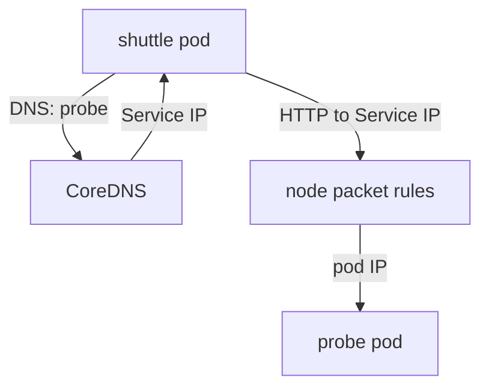

# Pod Traffic And The Network Boundary

Requests between pods do not go through the API server. They travel over the cluster network, and the API server never sees them. This part shows what the network layer checks by default, which is very little, and why a threat model must not treat "inside the cluster" as trusted.

## How A Request Reaches A Pod

A Service gives a set of pods one stable virtual IP address and a DNS name. When the `shuttle` pod sends a request to `probe`, the DNS server in the cluster (CoreDNS) answers with the Service IP. The node's packet rules, programmed by kube-proxy or the network plugin, rewrite the destination to the IP of one ready pod. The pod receives the request from the source IP of `shuttle`.

The Container Network Interface (CNI) plugin sets up this network. The Kubernetes network model requires that every pod can reach every other pod without address translation. That requirement describes reachability, not permission.



The diagram shows that no component in the path asks who the caller is.

## Observing The Default

Send a request from `shuttle` to `probe` in its own namespace:

<!-- astrona:playground:renew -->
```sh
kubectl exec -n starfleet deploy/shuttle -- curl -s http://probe/get
```

The `probe` workload is `go-httpbin`. It returns a JSON document that includes the request headers. Nothing in the request proves who sent it. Now send the same request from the `drifter` pod, which belongs to another team in another namespace:

```sh
kubectl exec -n outpost deploy/drifter -- curl -s http://probe.starfleet.svc/get
```

The request also succeeds. The name `probe.starfleet.svc` is the Service name followed by the namespace, and the cluster resolves it from any namespace. A namespace is a naming and permission scope in the API. It is not a network boundary.

To see the address the server sees, ask for the origin:

```sh
kubectl exec -n outpost deploy/drifter -- curl -s http://probe.starfleet.svc/ip
kubectl get pods -A -o wide
```

The first command returns the pod IP of `drifter`. The second command lists pod IP addresses, so you can match the origin to the pod. A source IP is weak evidence of identity. Pods are replaced and IP addresses are reused, so the same address can belong to a different pod later.

## What Controls Add

Three kinds of control change this picture. A NetworkPolicy restricts which pods may connect, based on labels, namespaces and ports, but only when the CNI plugin enforces it. Mutual TLS (mTLS) lets each side prove its identity with a certificate. Application authorization lets the server decide from a verified identity.

Each control answers a different question. A NetworkPolicy answers "may this pod connect". mTLS answers "who is the peer". Application authorization answers "may this caller do this operation". A request can pass the first two and still fail the third.

## Data Flow Beyond Requests

Data also flows through storage and logs. A pod writes to a volume, a database or standard output. The kubelet stores container logs on the node, and anyone with access to the node or to `pods/log` can read them. Add these flows to the diagram, with the authority required to read each one.

The part is complete when you can show that any pod reaches any other pod by default and name the control for each question. The task that follows applies the first principle to a real permission: give a workload access to only the one object it needs.

## Worked Reasoning: A Compromised Pod Looks Inward

Assume an attacker runs a command in the `shuttle` container. The attacker has no API permission, so the first look goes to the network. From inside the pod, the attacker can resolve every Service name through CoreDNS, for example with `nslookup probe.starfleet.svc`. Each answer is a possible target.

The attacker then probes ports. A Service lists its ports in its object, and a name lookup returns the address. Because the default network allows all connections, the attacker needs no permission to try them. The only limit is what each server does with an unauthenticated request. A server that answers any caller gives the attacker its data. A server that checks a credential or a client certificate gives the attacker only a rejection.

This is why a threat model separates reachability from authority. Reachability is cheap for the attacker and is limited by NetworkPolicy. Authority is limited by authentication and authorization in the receiving application. Both limits are needed, because a missing one is not covered by the other.

## What To Write In The Model

For each Service, record the callers that should reach it, the callers that can reach it today and the evidence the server uses to tell them apart. In the playground, the second list is every pod in the cluster and the third list is empty. The gap between the lists is the finding.

## The Boundary Between A Pod And Its Node

Pods on the same node share one kernel. The container runtime isolates them with Linux namespaces and control groups (cgroups), and a runtime default profile limits system calls. This isolation is strong when pods are configured without extra privileges. It weakens when a pod asks for more access, for example `privileged: true`, `hostNetwork: true`, `hostPID: true` or a `hostPath` volume.

Check the pods in the playground for these settings:

```sh
kubectl get pods -A -o jsonpath='{range .items[*]}{.metadata.namespace}{"/"}{.metadata.name}{"\t"}{.spec.hostNetwork}{"\t"}{.spec.hostPID}{"\n"}{end}'
```

An empty value means the field is not set. The system pods in `kube-system` may show `true` for `hostNetwork`, because control-plane components need it. The application pods in `starfleet` and `outpost` show empty values. A workload that sets one of these fields crosses the node boundary and gets the node's network or processes, so it belongs in the model as an entry point of its own.

## Common pitfalls

> [!WARNING]
> Do not treat a NetworkPolicy object as proof of enforcement. If the CNI plugin does not implement NetworkPolicy, the API accepts the object and the traffic still flows. Also, a Service name does not authenticate the server: another pod that gets the same name in a namespace is reached the same way.
