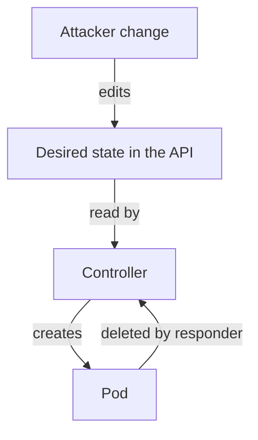

# What Can Survive A Container Replacement

In a threat model, persistence means maintaining unwanted access or behavior after the initial compromise or a restart. It is different from ordinary persistent storage, though stored data can be one mechanism. The defensive question is which changes can survive removing the process that first caused them.

## Resource State Can Outlive A Process

A compromised identity may be able to create another workload or alter a controller template. Deleting the currently suspicious Pod leaves the modified desired state available for reconciliation. The replacement can therefore run the same unwanted image or settings. Inspect controllers and configuration sources rather than treating one deleted instance as the complete scope.

Roles, bindings and credentials can also preserve authority. A changed grant or newly issued credential can remain valid after the original token is revoked. Recovery should examine the access configuration and credential lifecycle supported by the exposed identity's permissions. The actual scope follows its authority, not an assumption that all compromises have the same effect.

A GitOps controller can either help restore trusted intent or reapply compromised intent. If the source repository was changed, a healthy reconciler can continually restore the harmful declaration. The repository, build and registry are part of the recovery boundary as well as the live cluster.

## Stored Data And External Systems

An application with write access can change database records, shared files or object storage. Those changes can survive Pod replacement and image correction. A helper with a writable shared mount may affect the same data even if its own filesystem is disposable.

Replication can copy unwanted changes, while retention and snapshots can preserve evidence or earlier states. Determine which data was affected and whether a suitable recovery point exists. Restoring a current replica is not the same as restoring trustworthy historical content.

External systems can hold credentials, scheduled work or configuration used by the application. Removing a Kubernetes object may not remove those external effects. Incident scope needs the dependencies reachable through the compromised process or identity.

## Node And Management Trust

If compromise reached the host or runtime control path, workload replacement on the same node can inherit an untrusted execution environment. The response may require rebuilding or replacing the node through a trusted process and rotating accessible credentials. A new Pod identifier does not prove the kernel, runtime or mounted files are clean.

Administrative workstations and automation jobs can similarly retain exposed credentials or modified instructions. Restore the authority sources that continue making requests, not only the resources visible at the end of one incident timeline.

## A Defensive Recovery Sequence

Contain the identified access path and preserve useful evidence. Determine the actions possible under the compromised authority. Restore reviewed desired state and trusted artifacts, replace exposed credentials at their issuers and assess durable data changes. Then verify the intended workload and sensitive access paths.

These activities should follow actual evidence and known scope. A broad unexplained reset can destroy records while leaving an external credential valid. A narrow Pod deletion can leave durable changes untouched. The correct response explains why each restored boundary addresses a persistence route identified in the model.

## Seeing A Controller Replace A Deleted Pod

The idea that "deleting the Pod fixes it" is easy to test. A Deployment owns a ReplicaSet, and the ReplicaSet owns the pods. The ReplicaSet controller (part of kube-controller-manager) compares the number of pods it wants with the number that exist and creates new ones to close the gap. This process is called reconciliation.

<!-- astrona:playground:renew -->
First show who owns a pod:

```sh
kubectl get pods -n starfleet -l app=probe -o jsonpath='{.items[0].metadata.ownerReferences[*].kind}{"\n"}'
```

The answer is `ReplicaSet`. Delete the pod and list the pods again:

```sh
kubectl delete pod -n starfleet -l app=probe
kubectl get pods -n starfleet -l app=probe
```

The list shows a new pod with a new name and a young age. The pod was deleted and the desired state was not changed, so the controller built the same pod again. If the Deployment template had held an attacker's image, the new pod would run the attacker's image.

## Listing Every Object That Starts Work

An attacker with permission to create workloads has several places to hide. List them all with one command, sorted by creation time, so that the newest objects appear last:

```sh
kubectl get deployments,daemonsets,statefulsets,cronjobs -A --sort-by=.metadata.creationTimestamp
```

Each row is a controller that creates pods by itself. A DaemonSet starts one pod per node, a StatefulSet keeps pods with stable names and a CronJob starts a Job on a schedule. A CronJob is the quietest form, because no pod exists between runs.

In the playground you should see only the four example Deployments and the system workloads. In a real cluster, compare the list with what your deployment pipeline created. An object that the pipeline did not create, or that has an unusual namespace, image or creation time, needs an explanation.

## Ordinary Persistence Compared With Attacker Persistence

Applications keep state on purpose. A PersistentVolumeClaim keeps database files after a pod is replaced, and that is a normal feature. Attacker persistence uses the same mechanisms for a different goal, so the cluster cannot tell the two apart by mechanism. The difference is who created the state and whether it is part of the reviewed design.

Use this test for any durable object: was it created by the reviewed pipeline, and does the application need it? A volume that holds database files passes both questions. A ConfigMap that holds a script and is mounted into a pod by a job nobody can name fails both. The threat model needs a list of the durable places that exist by design, so everything else stands out.

The durable places in a cluster fall into four groups:

- Desired state in the API: controllers, templates, ConfigMaps and custom resources.
- Authority in the API: roles, bindings, service accounts and credential Secrets.
- Data in volumes and external services: files, databases and object storage.
- State on the node: files on host paths, container images and kubelet configuration.

## Why Reconciliation Helps Both Sides

Reconciliation is a repeated comparison of desired state and actual state. When the desired state is correct, it repairs damage without human action: a killed pod returns, a deleted object in a GitOps repository comes back. When the desired state is wrong, the same loop repairs the attacker's work. The attacker deletes nothing and only has to change the source once.



The diagram shows that deleting the pod feeds the controller again, while the attacker's edit of the desired state is the part that persists.

## Failure Case: The Clean Image That Comes Back Infected

A team finds a pod running a modified image. They rebuild the image from source, push it with the same tag and delete the pod. The new pod starts, and the unwanted behaviour is still there. The node had already cached the old image under that tag, and the pod uses `imagePullPolicy: IfNotPresent`, so the kubelet never pulled the new one. The persistence was in the node's image cache and in a mutable tag.

The fix is to reference images by digest, which names exact content, and to restore the pod from the digest. This example shows why recovery needs to name each place where state is kept, not only the object that was first noticed.

## Common pitfalls

> [!WARNING]
> Pod deletion removes one instance, not every configuration, credential or external effect. A healthy controller can reapply compromised desired state if its source remains untrusted.
