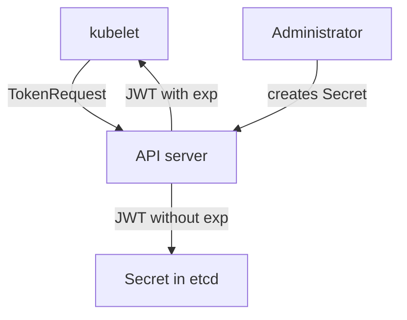

# Long-Lived Credentials

A credential is persistence when the attacker can use it after you remove everything else. The longer it lives and the fewer places record it, the better it works for the attacker. This part compares the two kinds of service account tokens, shows how to tell them apart and removes the long-lived kind.

## Two Kinds Of Service Account Tokens

A bound token is requested through the TokenRequest API. It is a signed JSON Web Token (JWT) with an expiry time (`exp`), and it is tied to an audience and, in a pod, to that pod. The kubelet requests and refreshes this token for the projected volume in each pod. When the pod is deleted, the API server stops accepting the token.

A legacy token is a Secret of type `kubernetes.io/service-account-token`. An administrator creates it by hand, with an annotation `kubernetes.io/service-account.name` that names a service account. The token controller then fills the Secret with a signed token that has no expiry. The token stays valid until someone deletes the Secret or the service account.



The diagram shows that the first token is issued on request and expires, while the second is stored in a Secret and has no expiry.

## Issuing A Short-Lived Token

<!-- astrona:playground:renew -->
Ask the API server for a ten-minute token for the `shuttle` service account and look at its claims. The `jq` filter splits the JWT at the dots, decodes the middle part and prints three claims:

```sh
kubectl create token shuttle -n starfleet --duration=10m | jq -R 'split(".")[1] | @base64d | fromjson | {sub, iat, exp}'
```

The output has three fields. `sub` is the service account user name, `iat` is the issue time and `exp` is the expiry, ten minutes after `iat`. After `exp`, the API server rejects the token. A stolen copy has a limited useful life.

## Creating A Legacy Token

Now create the legacy kind for comparison. Save this as `secret-shuttle-legacy-token.yaml`:

```yaml
apiVersion: v1
kind: Secret
metadata:
  name: shuttle-legacy-token
  namespace: starfleet
  annotations:
    kubernetes.io/service-account.name: shuttle
type: kubernetes.io/service-account-token
```

Apply it:

```sh
kubectl apply -f secret-shuttle-legacy-token.yaml
```

Then decode its claims with the same filter. The token is in the `token` data key, which is base64 encoded:

```sh
kubectl get secret shuttle-legacy-token -n starfleet -o jsonpath='{.data.token}' | base64 -d | jq -R 'split(".")[1] | @base64d | fromjson | {sub, exp}'
```

The token controller may need a few seconds to fill the Secret. When it is ready, the `exp` field is `null` because the token has no expiry. Anyone who reads this Secret holds a permanent credential for `shuttle`.

## Finding Legacy Tokens

Search every namespace for Secrets of this type. The field selector filters on the Secret type:

```sh
kubectl get secrets -A --field-selector type=kubernetes.io/service-account-token
```

The list should show the Secret you created. On a current cluster, no system component needs a legacy token, so every row is a candidate for removal. Check what each token's service account can do, then delete the Secret:

```sh
kubectl delete secret shuttle-legacy-token -n starfleet
```

Deleting the Secret invalidates that token at once, because the API server checks that the Secret still exists. Replace any real consumer, such as a pipeline, with a short-lived token that it requests when it runs.

## Other Credentials That Persist

Service account tokens are one kind. A client certificate in a kubeconfig file is valid until its expiry, and Kubernetes has no certificate revocation list. A stolen administrator kubeconfig therefore works until the certificate expires, unless the certificate authority is replaced. Cloud provider keys, registry passwords and API keys in Secrets have their own lifetimes at their issuers.

For each credential in the model, record where it is issued, how long it lives, where copies may exist and how it is revoked. A credential with no revocation path needs a short lifetime, because expiry is then the only control.

## Rotating After A Compromise

Rotate at the issuer. For service accounts, deleting and recreating the account changes its unique ID, so tokens that name the old ID stop working. For external keys, create a new key at the provider, deploy it and delete the old one. Restarting pods does not rotate anything by itself.

The part is complete when you can tell a bound token from a legacy token by its expiry, find the second kind with one command and remove it.

## Common pitfalls

> [!WARNING]
> Deleting a pod does not revoke a legacy token Secret, and copying the Secret to a file or a chat message creates a copy that deleting the Secret cannot reach, though the token itself stops working. Also, shortening a bound token's duration does not shorten the life of a legacy token that already exists.
