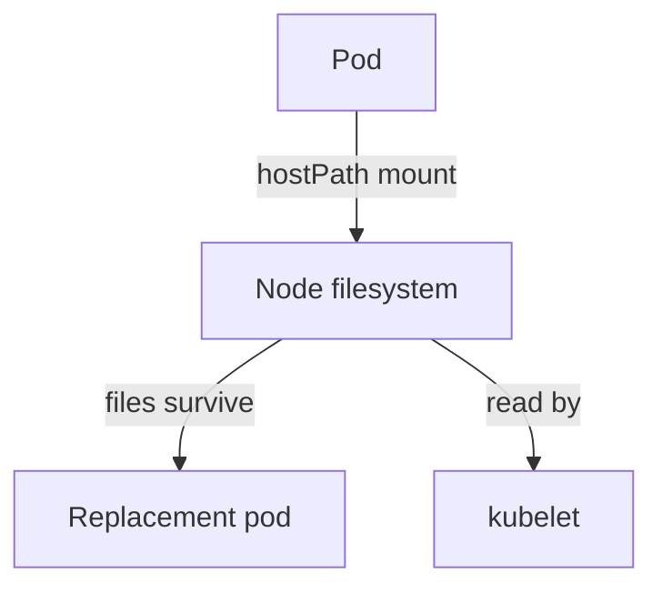

# Host Access And Recovery

A pod normally sees only its own filesystem. A pod that mounts a directory of the node sees the node's files. If it can write there, the change stays on the node after the pod is deleted, and other pods and the kubelet may read it. This part shows how to find such pods, how admission blocks them and what recovery means when a node was touched.

## What A hostPath Volume Does

A `hostPath` volume mounts a file or directory from the node into the container. The kubelet performs the mount, and the container runtime passes it into the container's mount namespace. Reads and writes go to the real node filesystem.

Some paths are especially sensitive. `/etc` holds node configuration. `/var/lib/kubelet` holds the kubelet's pod directories and projected tokens of other pods on the node. `/var/run` holds the container runtime socket. A pod that mounts the runtime socket can start any container on the node. A pod that mounts `/` can read and change everything.



The diagram shows that data written through a host path stays after the pod is replaced and is visible to other processes on the node.

## Finding Pods That Mount Host Paths

<!-- astrona:playground:renew -->
Search all pods for volumes of type `hostPath`. The command needs `jq`:

```sh
kubectl get pods -A -o json | jq -r '.items[] | select(any(.spec.volumes[]?; .hostPath != null)) | .metadata.namespace + "/" + .metadata.name + " " + ([.spec.volumes[] | select(.hostPath != null) | .hostPath.path] | join(","))'
```

On kind, the system pods in `kube-system` mount host paths, because components such as `kube-proxy` and the CNI plugin need node files. Application namespaces should show no rows. A row in an application namespace needs an owner and a reason.

Also check pods that share the node's process or network namespace:

```sh
kubectl get pods -A -o json | jq -r '.items[] | select(.spec.hostPID==true or .spec.hostNetwork==true or .spec.hostIPC==true) | .metadata.namespace + "/" + .metadata.name'
```

## Blocking Host Mounts With Admission

The Pod Security Admission controller enforces the Pod Security Standards per namespace. The `baseline` level forbids `hostPath` volumes, host namespaces and privileged containers. You switch it on with a namespace label. Save this as `namespace-outpost-baseline.yaml`:

```yaml
apiVersion: v1
kind: Namespace
metadata:
  name: outpost
  labels:
    pod-security.kubernetes.io/enforce: baseline
```

Apply it:

```sh
kubectl apply -f namespace-outpost-baseline.yaml
```

Now try to create a pod that mounts the node directory `/etc`. Save this as `pod-hostpath-test.yaml`:

```yaml
apiVersion: v1
kind: Pod
metadata:
  name: hostpath-test
  namespace: outpost
spec:
  containers:
    - name: test
      image: curlimages/curl:8.22.0
      command: ["sleep", "300"]
      volumeMounts:
        - name: node-etc
          mountPath: /host-etc
  volumes:
    - name: node-etc
      hostPath:
        path: /etc
```

Apply it:

```sh
kubectl apply -f pod-hostpath-test.yaml
```

The API server should refuse the request with a message that the pod violates PodSecurity `baseline` and that `hostPath` volumes are forbidden. The pod was rejected in the admission stage, so no pod exists to clean up.

The label applies to new pods only. Pods that already run in the namespace keep running even if they violate the level. To see which running pods would violate a level before you enforce it, run the label command with a server-side dry run, which prints warnings for each pod:

```sh
kubectl label namespace outpost pod-security.kubernetes.io/enforce=baseline --overwrite --dry-run=server
```

A namespace therefore needs both the label and a cleanup of the workloads that already run there.

## Recovery When A Node Was Touched

If an attacker had a writable host path or a privileged pod, you cannot know which files changed. Deleting the pod does not restore them. The trusted response is to replace the node: cordon it so no new pods are scheduled, drain it so pods move away, and delete it. A new node is built from a trusted image, and it holds no files from the old one.

Credentials that were readable on the node must be rotated. That includes the kubelet's client certificate, the tokens of every pod that ran there and any Secret mounted on the node. Treat the node as untrusted from the moment of the first writable mount.

The part is complete when you can find host path mounts, enforce the baseline level on a namespace and explain why a node replacement is the recovery for a host-level change.

## Common pitfalls

> [!WARNING]
> Pod Security labels do not remove pods that already violate the level. Also, `readOnly: true` on a hostPath mount protects the files from writes but still lets the pod read tokens and keys under that path.
