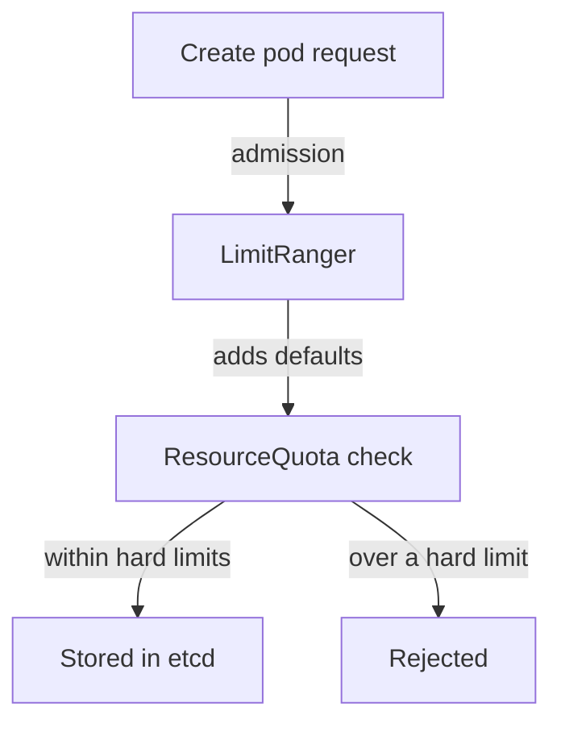

# Quotas And Limit Ranges

A single namespace can use up the shared capacity of a cluster if nothing stops it. A team that creates a thousand pods, or one pod with a very large request, harms every other team. A ResourceQuota caps a namespace in total. A LimitRange sets defaults and caps for each container. Used together they stop most accidental and deliberate overuse.

## What A ResourceQuota Counts

A ResourceQuota is a namespaced object. The API server checks it during admission. When a request would take the namespace over a hard limit, the API server rejects it with a 403 `Forbidden` error that says `exceeded quota`. The quota counts two kinds of things:

- Compute resources: `requests.cpu`, `requests.memory`, `limits.cpu`, `limits.memory`.
- Object counts: `pods`, `services`, `secrets`, `configmaps`, `persistentvolumeclaims` and the generic form `count/<resource>.<group>`.

There is an important side effect. When a quota covers `requests.cpu` or `limits.memory`, every new pod in that namespace must declare that value. A pod without it is rejected. A LimitRange removes that burden by filling in defaults.

## What A LimitRange Does

A LimitRange is also a namespaced object, and the `LimitRanger` admission plugin applies it. For containers it can set a default request (`defaultRequest`), a default limit (`default`), a minimum (`min`) and a maximum (`max`). The defaults are added to a pod that omits the values. The minimum and maximum make the API server reject a pod that is outside them.



The diagram shows that defaults are added before the quota is checked, so a pod with defaults still counts against the quota.

## Applying Both To A Namespace

<!-- astrona:playground:renew -->
Save this as `quota-outpost.yaml`:

```yaml
apiVersion: v1
kind: ResourceQuota
metadata:
  name: outpost-quota
  namespace: outpost
spec:
  hard:
    pods: "4"
    requests.cpu: "500m"
    requests.memory: 256Mi
    limits.memory: 512Mi
```

Apply it:

```sh
kubectl apply -f quota-outpost.yaml
```

Then check what the quota counts today. The running `drifter` pod already uses part of it:

```sh
kubectl describe resourcequota outpost-quota -n outpost
```

The table shows `Used` and `Hard` for each key. Now save the defaults as `limitrange-outpost.yaml`:

```yaml
apiVersion: v1
kind: LimitRange
metadata:
  name: outpost-defaults
  namespace: outpost
spec:
  limits:
    - type: Container
      defaultRequest:
        cpu: 50m
        memory: 32Mi
      default:
        memory: 128Mi
      max:
        memory: 256Mi
```

Apply it:

```sh
kubectl apply -f limitrange-outpost.yaml
```

Defaults apply to new pods only. To see them work without creating a pod, send a server-side dry run of a pod that sets no resources and read the result:

```sh
kubectl run probe-test -n outpost --image=curlimages/curl:8.22.0 --dry-run=server -o jsonpath='{.spec.containers[0].resources}{"\n"}'
```

The output should show the request and limit values from the LimitRange. The container asked for nothing, and the admission plugin filled the values in.

## Testing The Hard Limit

Ask for more pods than the quota allows. A dry run goes through quota admission too:

```sh
kubectl create deployment burst -n outpost --image=curlimages/curl:8.22.0 --replicas=6 --dry-run=server -o name
```

The dry run of a Deployment does not create pods, so it passes. The pods are created later by the ReplicaSet controller, and the quota rejects the ones over the limit. The ReplicaSet then shows `FailedCreate` events. This is a real point of confusion: the object is accepted and the pods are refused, so the symptom appears as missing pods, not as an error from `kubectl`.

## Limits Of Quotas

A quota stops one namespace from taking more than its share. It does not stop the sum of all quotas from exceeding the cluster. Platform teams need to size quotas against real capacity, or leave headroom. A quota also does not limit bandwidth, disk I/O or the number of requests to the API server. Those need other controls.

The part is complete when you can write a quota and a limit range, explain the order of the admission checks and recognise `exceeded quota` and `FailedCreate` as the signs of a cap.

## Choosing Numbers

Start from measured use. For a workload, take its typical usage and its peak, set the request near typical use and the limit near the peak plus headroom. For a namespace, add the requests of the workloads it should run, add a margin for a rolling update (a Deployment can run old and new pods together), and set the quota to that sum.

Review the quota when the team adds a workload. A quota that is too tight blocks a legitimate rollout. A quota that is too loose protects nothing. The `Used` column of `kubectl describe resourcequota` shows how close the namespace runs to its limit.

## Common pitfalls

> [!WARNING]
> A ResourceQuota on CPU or memory without a LimitRange makes every pod that omits those values fail, which can look like an outage. Also, a quota counts requests of pods that are `Pending`, so a stuck rollout can use up a quota without running anything.
