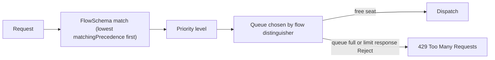

# Protecting The API Server With Priority And Fairness

Every action in a cluster goes through the Kubernetes API server: controllers, the kubelet on every node, deployment pipelines and people. The API server has a limited number of requests that it can process at the same time. A client that sends too many requests, for example a loop that lists all pods without a pause, can fill that capacity. Other clients then wait or fail, including the controllers that keep applications running. This part explains the mechanism that divides the capacity and how to add a rule for one noisy client.

## Older And Newer Protection

The older mechanism is a pair of API server flags, `--max-requests-inflight` and `--max-mutating-requests-inflight`. They set one global cap for read requests and one for write requests. When the cap is reached, new requests receive an HTTP 429 error (`Too Many Requests`) in order of arrival. A single noisy client can take all the slots, and an important request gets the same treatment as an unimportant one.

API Priority and Fairness (APF) replaces that with classification and queuing. It is on by default and uses the API group `flowcontrol.apiserver.k8s.io/v1`. It has two kinds of objects:

- A **FlowSchema** matches requests and assigns them to a priority level. It matches on the user, the groups or the service account of the requester, and on the verb, resource and namespace.
- A **PriorityLevelConfiguration** defines a pool of concurrency for one priority level and what happens when the pool is full.

## How A Request Moves Through APF



The steps are as follows.

1. The API server compares the request with all FlowSchemas. Those with a lower `matchingPrecedence` number are tried first. The first match wins.
2. The FlowSchema names a priority level. The request joins that level.
3. A flow is a group of requests that share a distinguisher, which is the user name or the namespace of the request. Within a level, each flow has its own queue, so one flow cannot starve another.
4. When a seat is free, the API server dispatches the next request fairly across the flows. When no seat is free the request waits in its queue (`Queue`) or is rejected at once (`Reject`).
5. A rejected request receives status 429 with a `Retry-After` header. A client that retries without waiting makes the situation worse.

The built-in objects include a level for system leader election, a level for workloads that run in the cluster, a `global-default` level and a `catch-all` flow for requests that match nothing else. The `exempt` level is never limited and is used by `system:masters`.

## Reading The Built-In Configuration

<!-- astrona:playground:renew -->
List the flow schemas and the levels:

```sh
kubectl get flowschemas
kubectl get prioritylevelconfigurations
```

Each flow schema row shows its priority level, its `MATCHINGPRECEDENCE` and its distinguisher method. Read one level in full:

```sh
kubectl get prioritylevelconfiguration workload-low -o yaml
```

In the `spec.limited` block, `nominalConcurrencyShares` is the weight of the level. The API server divides its total concurrency among the levels in proportion to their shares. `limitResponse` shows the queue settings. A level with a larger share gets more seats when the server is busy.

## Adding A Rule For One Noisy Client

Suppose a batch tool runs as the service account `batch-importer` in `starfleet` and sends bursts of requests. Give it a small pool that rejects when full. Save the level as `importer-level.yaml`:

```yaml
apiVersion: flowcontrol.apiserver.k8s.io/v1
kind: PriorityLevelConfiguration
metadata:
  name: importer-limited
spec:
  type: Limited
  limited:
    nominalConcurrencyShares: 5
    limitResponse:
      type: Reject
```

Then save the matching rule as `importer-flow.yaml`:

```yaml
apiVersion: flowcontrol.apiserver.k8s.io/v1
kind: FlowSchema
metadata:
  name: importer-flow
spec:
  matchingPrecedence: 5000
  priorityLevelConfiguration:
    name: importer-limited
  distinguisherMethod:
    type: ByUser
  rules:
    - subjects:
        - kind: ServiceAccount
          serviceAccount:
            name: batch-importer
            namespace: starfleet
      resourceRules:
        - verbs: ["*"]
          apiGroups: ["*"]
          resources: ["*"]
          clusterScope: true
          namespaces: ["*"]
```

Create the service account if it does not exist, then apply both files:

```sh
kubectl create serviceaccount batch-importer -n starfleet
kubectl apply -f importer-level.yaml -f importer-flow.yaml
```

The number 5000 is higher than the numbers of the system flow schemas, so the system rules are checked first and the new rule never catches system traffic. Check that the API server accepted the flow schema:

```sh
kubectl get flowschema importer-flow -o jsonpath='{.status.conditions}{"\n"}'
```

The conditions list should be empty or show no `Dangling` entry. A `Dangling` condition means the named priority level does not exist.

## Observing The Effect

The API server counts requests per flow schema and priority level. Send a few requests as the service account, then read the counters:

```sh
kubectl get pods -n starfleet --as=system:serviceaccount:starfleet:batch-importer
kubectl get --raw /metrics | grep apiserver_flowcontrol_dispatched_requests_total | grep importer
```

The first command is refused by RBAC because the account has no role, but the API server has already classified the request. The second command prints a counter for the `importer-flow` schema and the `importer-limited` level. The counter grows by one for each request that was dispatched.

## What APF Does Not Do

APF limits concurrency, not a rate per second. It protects the API server and not the etcd disk or a webhook behind it. A request that waits in a queue still counts for the time it waits. A very small level for a legitimate controller breaks that controller, so always check the usual traffic of a client before you give it a level.

## Common pitfalls

> [!WARNING]
> Putting a client that the cluster depends on, such as a controller, into a small `Reject` level turns a protection into an outage. Never change the built-in objects marked with the annotation `apf.kubernetes.io/autoupdate-spec`, because the API server resets them.
