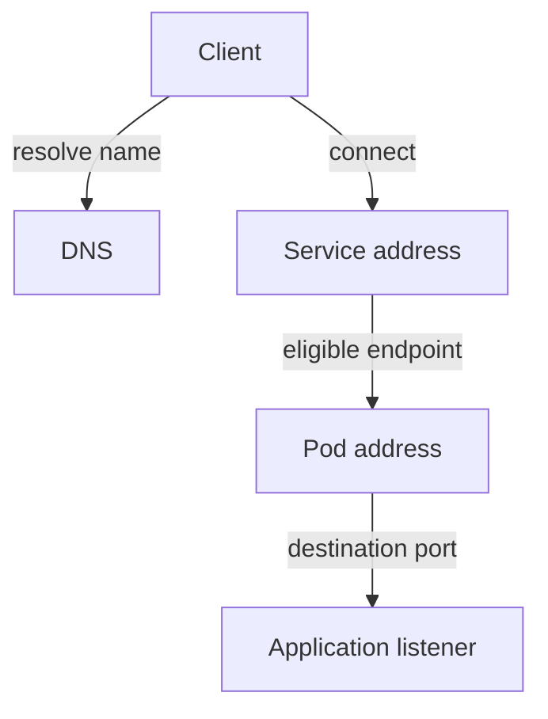

# Network Reachability And Request Evidence

The `shuttle` client cannot reach `probe`. A request path includes name resolution, a Service access point, eligible endpoints, network forwarding and the application listener. Troubleshooting should distinguish these stages before changing unrelated workload settings.

If the name does not resolve, inspect the requested Service name, namespace search behavior and Domain Name System (DNS) reachability. A network policy that blocks DNS can look like a discovery failure. If the name resolves, record what it resolves to and continue testing the connection path conceptually rather than assuming the backend is healthy.

If the Service has no usable endpoints, inspect its selector and Pod readiness. If endpoints exist, check the client-facing port and backend target port. A ready Pod can still be paired with a Service that forwards to the wrong port. The relevant evidence is the application listener and configured mapping.

A successful stage narrows the investigation but does not prove the later stages are working.

Direct backend reachability with failed Service access can implicate selection, forwarding or port mapping. Failures from only one source can implicate that source's routing or egress policy. Failures after a connection succeeds may belong to application behavior, authentication or a downstream dependency.

Preserve the original symptom and verify from the affected client context after correcting a supported cause. Testing from an administrator's machine may use a different namespace, route or policy and therefore cannot establish that the original caller recovered.

## Tracing One Caller Through The Path

Assume `shuttle` in `outpost` uses the short Service name `probe`, but `probe` exists in `starfleet`. That lookup can fail or target another resource before any intended backend connection happens. A correct namespace-qualified name addresses discovery, not a missing listener or blocked network path.

Now assume the correct name resolves to a Service address. Inspect whether its selector finds the intended Pods and whether endpoints are eligible. A Running Pod failing readiness can be excluded from ordinary traffic. A selector with no match yields a different backend problem. Both occur after a successful DNS answer.

If a suitable endpoint exists, check the mapping from client port to destination port. Direct Pod access on the correct port may work while the Service targets another port. That evidence points toward mapping rather than a universal Pod-network failure. Source egress and destination ingress policies can also restrict the connection even with correct discovery and ports.

## Interpreting Transport And Application Results

A refused connection often indicates that the destination can be reached well enough to reject the attempt, but the expected listener is absent or rejecting it. A timeout supports a different set of possibilities, including dropped traffic or an unresponsive dependency. These are clues that need context, not perfect diagnoses by themselves.

An HTTP response moves the investigation further into application or intermediary behavior. Identify which component produced the response; a gateway can return an error without the request reaching the application. A successful TCP connection does not prove application authentication or database access works.

After correction, verify through the original caller's namespace, identity and route. A test from another source can bypass the policy or naming rule that caused the problem. The full request path matters because restoring one stage is useful only when the intended operation can traverse the remaining stages too.

## Common pitfalls

> [!WARNING]
> Name resolution, endpoint selection, connection establishment and application responses are separate checks. Test the caller and path involved in the actual failure.
